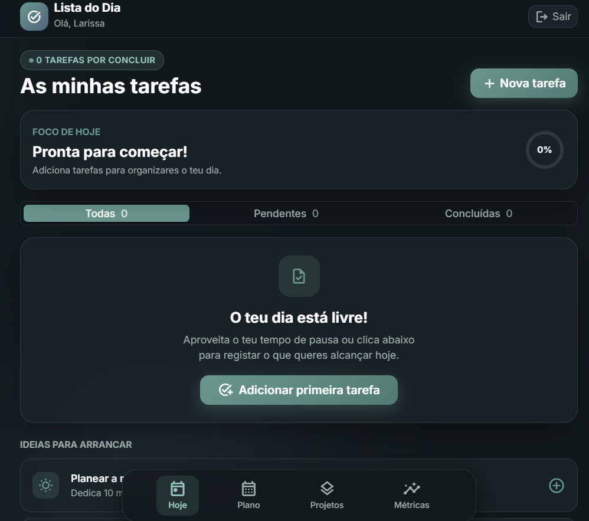
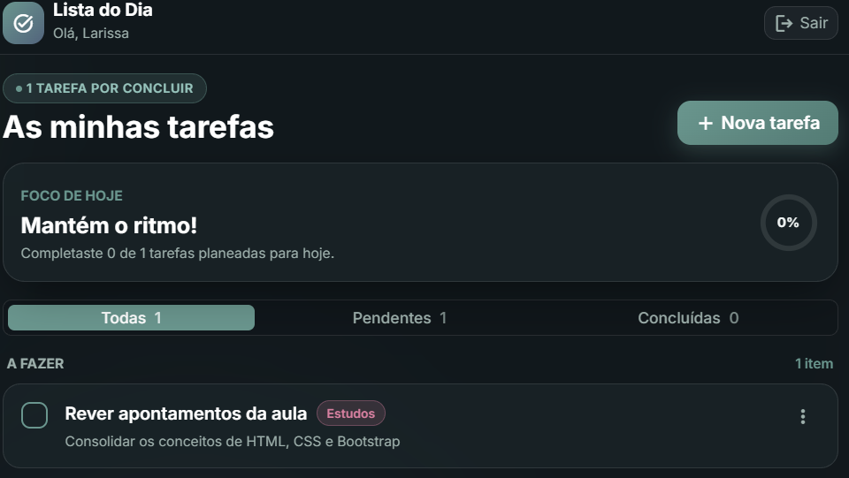

# Lista do Dia — Aplicação Pessoal de Gestão de Tarefas

## Interface

## 1. Objetivo
Aplicação web local (mobile-first e responsiva) para gestão pessoal de tarefas diárias, planeamento, organização por projetos e acompanhamento de métricas de produtividade. Funciona inteiramente no navegador do utilizador sem necessidade de servidor externo.

## 2. Identidade Visual e Paleta de Cores
A interface mantém a estrutura visual e o estilo moderno (*Glassmorphism* e cartões arredondados) dos protótipos na pasta `design/`, mas substitui a paleta original pela seguinte identidade cromática personalizada:

- **Fundo Principal (Surface / Background):** `#11181C` (Ardósia escuro profundo com subtom esverdeado)
- **Superfícies e Cartões (Cards):** `#192428` e `#223036` (com transparência e efeito *blur*)
- **Cor Primária (Botões principais, destaques e progresso):** `#6A968E` (Verde Sálvia)
- **Cor Secundária / Complementar (Alertas suaves, etiquetas de destaque):** `#D680A0` (Rosa Seco)
- **Cores de Apoio (Análogas e Tríade para categorias e gráficos):**
  - Azul Ardósia: `#52647C`
  - Lilás Suave: `#9B59B6`
  - Framboesa / Urgente: `#B03E5E`
  - Violeta Índigo: `#6D52C4`
- **Texto Principal:** `#F1F5F4` | **Texto Secundário:** `#9EB0AC`
- **Tipografia:** `Inter` (Google Fonts) + `Material Symbols Outlined` para ícones.

## 3. Autenticação e Segurança Local (Conta Única)
- **Uso Pessoal:** A aplicação permite criar **apenas uma conta local** (guardada no `localStorage`). Se já existir uma conta registada, a opção de criar nova conta fica bloqueada.
- **Registo Inicial:** Nome, email, palavra-passe (mínimo 8 caracteres) e **duas perguntas de segurança** definidas pelo utilizador para recuperação.
- **Iniciar e Terminar Sessão:** Protege o acesso às tarefas no computador. A palavra-passe e as respostas de segurança são guardadas com hash (`SHA-256` via Web Crypto API), nunca em texto simples.
- **Recuperação de Palavra-passe ("Esqueceu-se?"):** Ao responder corretamente às duas perguntas de segurança, o utilizador pode definir uma nova palavra-passe.

## 4. Funcionalidades Principais (4 Vistas)
1. **Hoje (Ecrã Principal):**
   - Cabeçalho com contador de tarefas por concluir e botão `+ Nova tarefa`.
   - Cartão de foco diário com barra/arco de progresso percentual (`%`).
   - Filtros rápidos: *Todas*, *Pendentes* e *Concluídas*.
   - Cartões de tarefa com checkbox para concluir, prioridade, etiqueta de projeto, data/hora, menu de contexto (*Editar* / *Eliminar* com modal de confirmação) e estado vazio (*"O teu dia está livre!"*) com sugestões rápidas.
2. **Plano:**
   - Visualização cronológica das tarefas agrupadas por prazo: *Em atraso*, *Hoje*, *Amanhã* e *Próximos dias*.
3. **Projetos:**
   - Gestão de categorias/pastas (ex.: *Trabalho*, *Pessoal*, *Estudos*) com cor personalizada da paleta, permitindo criar novos projetos e filtrar tarefas por projeto.
4. **Métricas:**
   - Painel resumo com total de tarefas criadas, concluídas, pendentes, taxa de conclusão e distribuição visual por projeto e prioridade.

## 5. Persistência de Dados
- Todos os dados (utilizador, sessão, tarefas e projetos) são armazenados localmente no navegador através de `localStorage`.